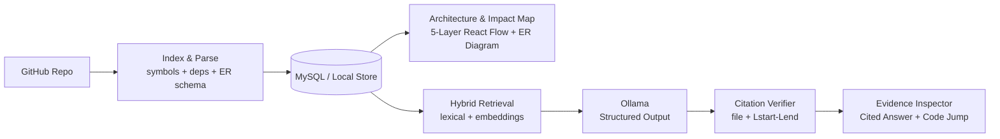

<div align="center">


<br/>

[](https://visualrepo.netlify.app/)


**Index a GitHub repo → see its architecture → ask questions → get answers with receipts.**

[🌐 Live Website](https://visualrepo.netlify.app/) · [Quick Start](#-quick-start) · [Tech Stack](#-tech-stack) · [How It Works](#-how-it-works)

</div>

---

> **VisualRepo** indexes GitHub repositories, extracts language-specific symbols, dependency graphs, and database schemas, visualizes the layered architecture and Entity-Relationship (ER) diagrams interactively with **React Flow**, computes multi-hop **blast radius impact analysis**, and answers engineering questions using **Ollama Structured Outputs** where every claim cites **exact source files and 1-based line ranges (`Lstart-Lend`)**.

## ✨ Highlights

| | Feature |
|---|---|
| 🗺️ | **Layered architecture graph** powered by React Flow, organized into 5 swimlanes (`Presentation & Client` → `API & Entry Points` → `Business Logic & Services` → `Data Access & Storage` → `Domain Models & Config`) with barycenter crossing minimization |
| ⚡ | **Multi-hop Impact Analysis (Blast Radius)**: inspect upstream dependencies, direct & transitive downstream dependents, affected layers, and change risk (`LOW` / `MEDIUM` / `HIGH`) for any file |
| 🗃️ | **Polyglot Database ER Diagram**: automatically extracts tables, columns, PK/FK constraints, and relationships from JPA/Hibernate entities, SQL DDL, Python ORMs/Pydantic, Prisma, and TypeScript schemas with click-to-line navigation |
| 🔎 | **Two-stage retrieval**: lexical + AST symbol/dependency indexing (`BASIC_INDEX`), plus dense embeddings with cosine-similarity hybrid search (`VECTOR_HYBRID`) |
| 📌 | **Evidence-cited AI answers**: every claim is verified server-side against real indexed files and `Lstart-Lend` line ranges, jumping straight into the Shiki syntax-highlighted **Evidence Inspector** |
| 🎛️ | **Customizable IDE Workspace**: custom **Dark** (*Midnight Obsidian*) & **Light** (*Daylight Blueprint*) themes, drag-to-swap panels with FLIP animations, interactive splitters, and detachable Left/Right **Side Boxes** |
| 🗄️ | **Zero-friction database**: MySQL 8.4 (XAMPP or Docker) with an automatic local MySQL-compatible fallback |

---

## 🧰 Tech Stack

| Layer | Technology |
|---|---|
| **Frontend** | React 18, TypeScript, Vite, Tailwind CSS v4, React Flow (`@xyflow/react`), Shiki Syntax Highlighter, Lucide Icons |
| **Backend** | Java 21, Spring Boot 3.3, Spring Data JPA, Validation |
| **Repository Access** | GitHub REST API (`/repos/{owner}/{repo}`, recursive Git trees, raw/blob content) |
| **Code & Schema Analysis** | Polyglot symbol/dependency analyzer + ER schema parser (Java/Kotlin JPA, SQL DDL, Python SQLAlchemy/Django/Pydantic, Prisma, TypeScript/JS) |
| **AI & Citations** | Ollama `/api/chat` with strict JSON Schema structured outputs + Server-side line-range verifier & deterministic offline fallback |
| **Retrieval (2-Stage)** | **Stage 1**: Basic lexical + AST symbol & dependency graph indexing<br>**Stage 2**: Dense Embeddings (`/api/embed`) + Cosine Similarity Vector Hybrid search |
| **Database** | MySQL 8.4 (with automatic local MySQL-compatible fallback if port `3306` is offline) |

---

## 🧭 How It Works



---

## 🚀 Quick Start

### 1. Start Infrastructure (Optional if using local Ollama)
```bash
docker compose up -d mysql
```
> [!NOTE]
> If MySQL on `:3306` is not running, the backend automatically falls back to a persistent MySQL-compatible database in `./backend/data/visualrepo_db` so you can run immediately without Docker.

### 2. Run the Spring Boot 3 Backend (Java 21)
```bash
cd backend
mvn spring-boot:run
```
The backend starts at `http://localhost:8080` and automatically indexes the multi-language showcase repository (`demo/order-payment-platform`) on first startup.

### 3. Run the React + Vite Frontend
```bash
cd frontend
npm install
npm run dev
```
Open **http://localhost:5173** in your browser.
